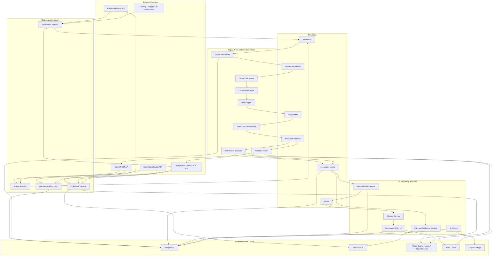
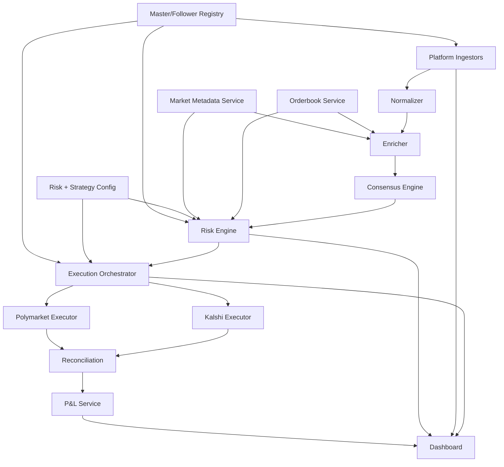
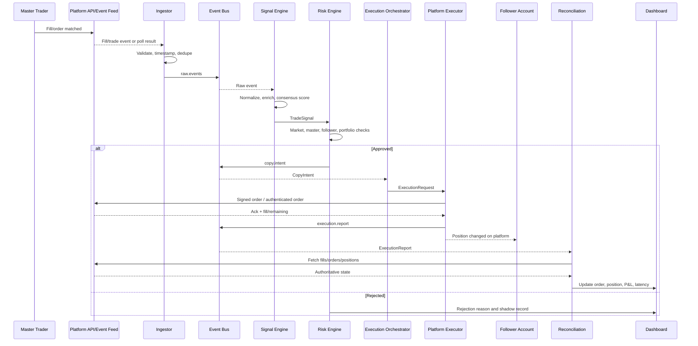
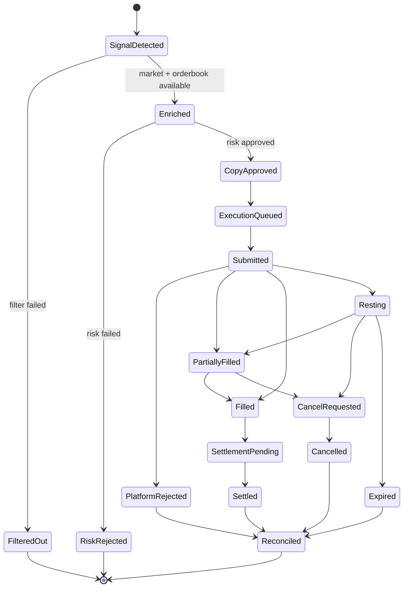
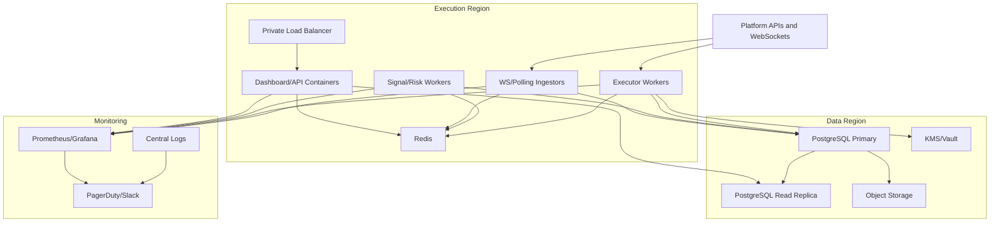

# Prediction Market Trade Copier PRD and Technical Architecture

Version: 1.0
Date: 2026-05-17
Owner: Product / Engineering
Status: Build-ready planning document

## 1. Executive Summary

This product is an automated prediction market trade copier that monitors a configured set of high-performing master traders across Polymarket and Kalshi, converts detected master activity into normalized trade signals, applies profitability and risk controls, and executes scaled copy trades into one or more authorized follower accounts.

Polymarket is treated as a Polygon-based CLOB venue with public market data, public wallet-level activity, EIP-712 signed orders, and on-chain settlement. Current Polymarket docs describe CLOB order matching as offchain with on-chain settlement on Polygon, and current API docs use Gamma API for market discovery, Data API for user/trade analytics, and CLOB API for orderbook and trading. New API users should plan for deposit-wallet flows and pUSD-facing collateral semantics, while still reconciling Polygon token movement and USDC-derived collateral at settlement.

Kalshi is treated as a USD-denominated, CFTC-regulated Designated Contract Market with authenticated REST and WebSocket APIs for account, market data, orders, fills, positions, and settlements. Unlike Polymarket wallets, arbitrary Kalshi trader accounts are not publicly attributable through a wallet address. Kalshi master monitoring therefore requires explicit master authorization, such as read-only API credentials, subaccount access, or another permitted integration arrangement.

The core objective is:

1. Monitor master trader activity.
2. Detect new position changes or fills.
3. Convert each event into an auditable normalized signal.
4. Filter, enrich, score, and deduplicate the signal.
5. Allocate risk-adjusted target sizes per follower.
6. Execute follower orders with bounded slippage and idempotency.
7. Reconcile fills, positions, settlements, and P&L.
8. Provide real-time observability, controls, and alerts.

Target production latency is 2 to 5 seconds from master fill detection to follower order submission for normal liquid markets. A lower-latency Polymarket path is possible using direct market WebSockets plus Goldsky or direct Polygon event ingestion, but wallet-attributed master detection is constrained by the data source used.

### System Overview and Goals

The system is a real-time copy-trading infrastructure for prediction markets. It observes trusted master accounts, detects market/outcome-specific trades, translates those events into platform-neutral signals, applies filters and risk controls, then places equivalent scaled trades for follower accounts. For Polymarket, the system handles Polygon wallet identity, CLOB token IDs, outcome tokens, signed CLOB orders, and on-chain settlement. For Kalshi, the system handles authenticated account-level fills, USD event contracts, YES-leg order semantics, REST/WebSocket trading APIs, and centralized settlement records. The main business goal is profitability parity: followers should reproduce the risk-adjusted exposure of selected masters closely enough that slippage, latency, fees, missed fills, and risk filters do not erase the masters' edge.

## 2. Source Baseline and Platform Constraints

This PRD is based on current public documentation verified on 2026-05-17.

Primary platform facts that drive the architecture:

- Polymarket has three primary APIs: Gamma for market discovery, Data API for user positions/trades/activity, and CLOB API for orderbook/trading. The Gamma and Data APIs are public; CLOB trading requires authentication. Source: [Polymarket API overview](https://docs.polymarket.com/api-reference/introduction).
- Polymarket CLOB trading uses EIP-712 order signing plus L2 HMAC credentials. Source: [Polymarket trading overview](https://docs.polymarket.com/trading/overview).
- Polymarket market WebSocket streams orderbook snapshots, price changes, trades, best bid/ask, new market, and resolution events. The authenticated user channel streams only the authenticated user's order and trade activity. Source: [Polymarket WebSocket overview](https://docs.polymarket.com/market-data/websocket/overview).
- Polymarket Data API exposes user-filtered trades including `proxyWallet`, `side`, `asset`, `conditionId`, `size`, `price`, `timestamp`, `outcome`, and `transactionHash`. Source: [Polymarket get trades](https://docs.polymarket.com/api-reference/core/get-trades-for-a-user-or-markets).
- Polymarket migrated to v2 contracts on 2026-04-28 according to Goldsky's Polymarket integration docs. Existing public subgraph endpoints may be incomplete or incorrect; Goldsky Turbo Pipelines with v2 Polymarket datasets are the recommended current path for on-chain activity replication. Source: [Goldsky Polymarket docs](https://docs.goldsky.com/chains/polymarket).
- Kalshi is regulated by the CFTC as a Designated Contract Market. Source: [Kalshi regulated status](https://help.kalshi.com/en/articles/13823765-how-is-kalshi-regulated).
- Kalshi has REST, WebSocket, FIX, and official SDK documentation. The docs recommend production clients use REST/OpenAPI and WebSocket/AsyncAPI as the source of truth. Source: [Kalshi API welcome](https://docs.kalshi.com/welcome/index) and [Kalshi SDKs](https://docs.kalshi.com/sdks/overview).
- Kalshi WebSocket connections require API key authentication even for public channels; supported channels include orderbook deltas, ticker, public trades, user fills, user orders, and lifecycle events. Source: [Kalshi WebSocket connection](https://docs.kalshi.com/websockets/websocket-connection).
- Kalshi V2 order creation uses `/portfolio/events/orders`, with `side` as `bid` or `ask` on the YES leg, `count`, fixed-point dollar `price`, and `time_in_force` values such as `fill_or_kill`, `good_till_canceled`, and `immediate_or_cancel`. Source: [Kalshi create order V2](https://docs.kalshi.com/api-reference/orders/create-order-v2).

## 3. Problem Statement

High-performing prediction market traders can move quickly across hundreds or thousands of event contracts. Manually copying their trades is slow, inconsistent, and vulnerable to missed fills, poor sizing, slippage, and uncontrolled correlated exposure. Existing alerting or social-trading tools often stop at notification and do not solve full-cycle execution, risk management, reconciliation, and P&L attribution.

The product must provide an end-to-end automated copy infrastructure that can:

- Track 10+ masters across two materially different venues.
- Normalize different identifiers, collateral units, order semantics, and settlement models.
- Decide which master trades are worth copying.
- Replicate positions into N follower accounts with independent risk profiles.
- Preserve a complete audit trail from raw master event to follower fill.
- Detect when the system is falling out of parity with masters and stop copying if risk thresholds are breached.

## 4. Goals and Non-Goals

### Goals

- Monitor 10+ master traders concurrently across Polymarket and Kalshi.
- Detect new master fills or position changes with target detection latency under 2 seconds for WebSocket/event-stream paths and under 5 seconds for polling paths.
- Normalize all master activity into a single internal trade signal model.
- Copy eligible trades into one or more follower accounts with per-follower sizing and risk controls.
- Maintain idempotent execution so duplicated ingestion events do not produce duplicated follower orders.
- Track copy accuracy, latency, slippage, fill ratio, P&L delta, master performance, and follower performance.
- Provide a real-time dashboard and operational controls to pause masters, categories, markets, followers, and the whole system.
- Reconcile positions and P&L against authoritative platform APIs and on-chain data.

### Non-Goals

- This system does not guarantee profitability.
- This system does not evade platform rules, jurisdictional restrictions, KYC, API limits, or market access controls.
- This system does not copy Kalshi accounts without explicit authorization or approved account access.
- This system does not custody user funds outside authorized follower platform accounts and wallets.
- MVP does not implement autonomous market making, cross-venue arbitrage, or strategy generation beyond copy-trade signal processing.
- MVP does not infer private Kalshi trader identity from public trade flow.

## 5. Definitions

- Master trader: A configured trader whose activity is monitored. On Polymarket this is usually a wallet or proxy/deposit wallet address. On Kalshi this is an authorized account, subaccount, or API credential set.
- Follower account: An account or wallet controlled by the system operator or consenting user where copy trades are placed.
- Master event: A raw trade, fill, order, position delta, or settlement event from an external platform.
- Trade signal: A normalized, enriched, risk-scorable representation of a master position change.
- Copy intent: A post-risk decision stating that a follower should place, skip, scale down, close, or hedge a position.
- Execution request: A platform-specific order placement request generated from a copy intent.
- Execution report: A platform response or follow-up fill/order update.
- Consensus group: A cluster of signals for the same normalized event, market, outcome, and direction within a time window.
- Copy accuracy: The share of eligible master signals that produce intended follower exposure within configured tolerance.
- P&L delta: Difference between master return and follower return after slippage, fees, sizing drift, missed fills, and settlement.

## 6. Success Metrics

### Copy Quality

- Copy accuracy: `eligible_signals_copied / eligible_signals_total >= 98%`.
- Duplicate order rate: `< 0.1%` of execution requests.
- Missed-signal rate from ingestion failures: `< 0.5%` daily.
- Follower exposure parity: `abs(follower_actual_target_notional - follower_desired_target_notional) / desired <= 5%` for markets with sufficient liquidity.

### Latency

- Master event detection latency:
  - Polymarket WebSocket/Goldsky path: p50 `< 1.5s`, p95 `< 4s`.
  - Polymarket Data API polling fallback: p50 `< 3s`, p95 `< 8s`.
  - Kalshi user WebSocket fills: p50 `< 1.5s`, p95 `< 4s`.
  - Kalshi REST polling fallback: p50 `< 3s`, p95 `< 8s`.
- Signal processing latency: p95 `< 250ms`.
- Risk decision latency: p95 `< 150ms`.
- Follower order submission latency after risk approval: p95 `< 1s`.
- End-to-end target: p95 `< 5s` for normal operation.

### Price and P&L

- Average price slippage vs master entry: `< 1.5 cents` for liquid binary markets, configurable by category.
- Max accepted slippage per trade: default `3 cents` unless master/category override applies.
- Follower P&L delta vs scaled master P&L: weekly median within `5%` of master ROI for copied trades.
- Fill ratio: `filled_target_notional / approved_target_notional >= 90%` for immediate-or-cancel/FAK execution in liquid markets.

### Reliability

- Core service uptime: `99.5%` MVP, `99.9%` v1.
- No loss of raw external events once received by ingestion service.
- Recovery point objective: `< 60s`.
- Recovery time objective: `< 15m` MVP, `< 5m` v1.

## 7. Users and Use Cases

### User Personas

- System operator: Configures masters, followers, risk limits, and platform credentials.
- Portfolio manager: Reviews P&L, master quality, exposure, drawdown, and category performance.
- Follower account owner: Authorizes one or more follower accounts and sets individual risk limits.
- Engineer/on-call: Monitors service health, data gaps, failed executions, queue depth, and reconciliation breaks.

### User Stories

- As an operator, I can add a Polymarket master wallet address and begin tracking its public fills and positions.
- As an operator, I can add a Kalshi master only after receiving authorized API access or approved account/subaccount access.
- As a follower owner, I can set maximum bankroll percentage per trade, per market, per category, and per day.
- As a portfolio manager, I can see every copied trade with master timestamp, signal timestamp, risk approval timestamp, order submission timestamp, fill timestamp, and final latency.
- As an operator, I can pause copying a master without losing historical monitoring.
- As an operator, I can pause a category, such as sports or politics, across all masters and followers.
- As an engineer, I can replay raw events into the signal engine in dry-run mode to reproduce a decision.
- As an on-call engineer, I receive alerts when slippage, failed orders, API throttling, stale WebSockets, or reconciliation drift exceed thresholds.

## 8. Functional Requirements by Module

### 8.1 Master Trader Monitoring Layer

#### FR-MON-001: Master Registry

The system must maintain a registry of masters with:

- `master_id`
- `display_name`
- `platforms_enabled`
- `polymarket_addresses[]`
- `kalshi_account_ref`
- `status`: `active`, `paused`, `probation`, `disabled`
- `categories_allowed[]`
- `categories_blocked[]`
- `min_trade_notional`
- `max_signal_age_seconds`
- `master_weight`
- `created_by`
- `created_at`
- `last_seen_at`

#### FR-MON-002: Polymarket Monitoring

The production Polymarket ingestion stack must support four sources, in priority order:

1. Goldsky Turbo Pipeline or equivalent v2 on-chain data feed:
   - Subscribe to `polymarket.order_filled`, `polymarket.orders_matched`, and `polymarket.user_positions`.
   - Filter by `user_id in configured_master_addresses`.
   - Deliver to ingestion webhook or Kafka/Redpanda sink.
   - Use `order_filled` for granular per-user fills and `orders_matched` for taker activity.
2. Polymarket Data API fallback:
   - Poll `GET https://data-api.polymarket.com/trades?user={address}&limit=100`.
   - Keep per-address cursor using max `timestamp` plus `transactionHash`/`asset`/`side`/`size` dedupe key.
   - Poll interval: 1s for top-priority masters, 2 to 5s for lower-priority masters, rate-limit adaptive.
3. Direct Polygon event ingestion:
   - Subscribe to Polygon RPC/WebSocket logs for current Polymarket v2 exchange contracts and CTF token contracts.
   - Decode fill and token transfer events.
   - Join token IDs to markets using Gamma/CLOB metadata.
   - Use as a reconciliation and redundancy path unless engineering commits to maintaining contract ABIs and migration tracking.
4. Polymarket market WebSocket:
   - Subscribe to tracked token IDs for `last_trade_price`, `price_change`, `best_bid_ask`, `market_resolved`, and `tick_size_change`.
   - Use for liquidity and market context.
   - Do not use as the sole wallet-attributed master detection source because public market events are not sufficient to attribute arbitrary trades to a master wallet.

Subgraph requirement:

- The system may support legacy The Graph/subgraph queries only as historical or best-effort analytics where validated.
- It must not rely on old public subgraph endpoints as the production source of truth for post-2026-04-28 Polymarket v2 activity unless the endpoint is proven v2-complete.

#### FR-MON-003: Kalshi Monitoring

Kalshi master monitoring must be account-authorized:

- Preferred real-time path:
  - Open authenticated Kalshi WebSocket connection for each authorized master credential or grouped credentials where permitted.
  - Subscribe to `fill` channel with no market filter or a managed list of tracked markets.
  - Optionally subscribe to `user_orders` to join fills back to order status and time-in-force.
- Fallback polling path:
  - Poll `GET /portfolio/fills` with `min_ts` and cursor.
  - Poll `GET /portfolio/positions` periodically to catch missed deltas.
  - Poll `GET /portfolio/orders` or `GET /portfolio/events/orders/{id}` if needed to enrich order type.
- Public Kalshi trades:
  - Subscribe to public `trade` WebSocket or `GET /markets/trades` only for market microstructure and liquidity.
  - Public trades must not be represented as a specific master's activity because public messages contain trade details but not master account identity.

Kalshi monitoring must store credential scope:

- `read_only`: ingest fills/positions only.
- `trade_enabled`: only for follower accounts, never required for master accounts.
- `subaccount`: optional subaccount number.
- `allowed_markets`: optional filter.

#### FR-MON-004: Cross-Platform Masters

A single `master_id` may have:

- One or more Polymarket addresses.
- One or more Kalshi account/subaccount credential references.
- Platform-specific confidence weights.
- Platform-specific category expertise.

The signal engine must not assume the same person has identical bankroll, risk tolerance, or expertise across both venues. Master scoring is computed per `(master_id, platform, category)` and then aggregated.

#### FR-MON-005: Exact Position Detection

The ingestion layer must capture:

- Platform.
- Master ID.
- External account address or account reference.
- Market identifier:
  - Polymarket: condition ID, token/asset ID, event slug, market slug.
  - Kalshi: market ticker, event ticker.
- Outcome:
  - Polymarket: token outcome, usually YES/NO or multi-outcome option.
  - Kalshi: YES/NO exposure normalized from YES-leg book semantics.
- Side/action:
  - `buy`, `sell`, `increase_long`, `decrease_long`, `flip`, `close`.
- Size:
  - Shares/contracts.
  - Notional in platform currency.
- Entry price.
- Fees if available.
- Timestamp:
  - Source event timestamp.
  - Ingestion receive timestamp.
- Execution role:
  - `taker`, `maker`, `unknown`.
- Order type where available:
  - Polymarket public data may support maker/taker and fill role but not always original TIF.
  - Polymarket authenticated user channel can expose order type for authorized accounts.
  - Kalshi master order type requires authorized order data joined to fills.

### 8.2 Signal Processing Engine

#### FR-SIG-001: Raw Event Schema

All external events must first be persisted as immutable raw events.

```json
{
  "raw_event_id": "uuid",
  "source": "polymarket_goldsky|polymarket_data_api|polygon_rpc|kalshi_ws|kalshi_rest",
  "platform": "polymarket|kalshi",
  "external_event_id": "transaction_hash:log_index or trade_id/fill_id",
  "master_id": "uuid",
  "account_ref": "wallet_or_credential_ref",
  "received_at": "2026-05-17T15:20:03.123Z",
  "source_timestamp": "2026-05-17T15:20:01.987Z",
  "payload": {},
  "payload_hash": "sha256",
  "schema_version": "raw.v1"
}
```

Idempotency key:

```text
platform + source + external_event_id + account_ref
```

#### FR-SIG-002: Normalized Trade Signal Schema

```json
{
  "signal_id": "uuid",
  "schema_version": "signal.v1",
  "platform": "polymarket",
  "master_id": "uuid",
  "source_event_ids": ["uuid"],
  "market_id": "0x_condition_or_kalshi_ticker",
  "event_id": "event_slug_or_event_ticker",
  "normalized_event_key": "sha256(normalized_ruleset)",
  "platform_market_ref": {
    "condition_id": "0x...",
    "asset_id": "123456789",
    "ticker": null,
    "event_ticker": null
  },
  "outcome": "YES",
  "side": "buy",
  "position_effect": "open|increase|decrease|close|flip|unknown",
  "size_contracts": "100.0000",
  "notional": "56.0000",
  "currency": "USDC|pUSD|USD",
  "entry_price": "0.5600",
  "fee": "0.0000",
  "is_taker": true,
  "order_type": "marketable_limit|limit|fok|ioc|gtc|unknown",
  "event_timestamp": "2026-05-17T15:20:01.987Z",
  "detected_at": "2026-05-17T15:20:03.123Z",
  "market_close_time": "2026-05-18T00:00:00.000Z",
  "category": "politics|sports|crypto|economics|culture|other",
  "confidence_score": 0.82,
  "master_quality_score": 0.76,
  "consensus_group_id": "uuid|null",
  "liquidity_snapshot_id": "uuid",
  "status": "new|filtered|approved|rejected|expired"
}
```

#### FR-SIG-003: Parsing Rules

Polymarket:

- Map `conditionId` to canonical market.
- Map `asset` token ID to outcome using Gamma/CLOB metadata.
- Use `side=BUY/SELL` and `outcome` to infer desired exposure.
- Compute notional as `size * price` for buys and `size * price` or proceeds for sells.
- If Goldsky event has `amount_usdc`, use it as source notional and store computed notional as secondary.
- Use `transactionHash`, `order_hash`, and log index or event ID for dedupe.

Kalshi:

- Map `market_ticker` or `ticker` to canonical market.
- Convert Kalshi V2 YES-leg book fields to normalized exposure:
  - `bid` on YES leg means buy YES.
  - `ask` on YES leg means sell YES, economically equivalent to buying NO at `1 - yes_price`.
- Use `action`, `side`, `outcome_side`, `book_side`, `yes_price_dollars`, and `no_price_dollars` from fills when available.
- Compute notional as `count_fp * selected_outcome_price`.
- Join `fill.order_id` to `user_order` or REST order detail to capture order state and order type.

#### FR-SIG-004: Filtering Logic

Default copy filters:

- Minimum master notional:
  - Polymarket: `$25` MVP default.
  - Kalshi: `$25` MVP default.
  - Per-master override allowed.
- Minimum follower target notional after scaling: `$5` or platform minimum, whichever is higher.
- Maximum signal age:
  - Realtime: reject if older than `10s`.
  - Polling fallback: reject if older than `30s` unless marked as position-sync copy.
- Market close cutoff:
  - Reject if market closes in `< 24h` by default.
  - Allow category/master override for short-duration crypto/sports markets if strategy explicitly supports them.
- Liquidity:
  - Reject if best executable depth within max slippage cannot fill at least `min(80% target, platform_min_order)`.
  - Reject if spread exceeds category threshold, default `> 8 cents`.
  - Reject if platform market reports `paused`, `closed`, `settled`, disabled order book, or stale orderbook.
- Open interest / volume:
  - Reject if open interest or liquidity below configured threshold, default `$2,500` for MVP unless category override applies.
- Price:
  - Reject if entry price is outside configured copy range, default `< 0.03` or `> 0.97` unless closing/reducing.
- Category:
  - Apply follower category allow/block list.
- Master health:
  - Reject or scale down if master is below rolling quality threshold.
- Follower risk:
  - Reject if per-trade, per-market, per-category, daily loss, drawdown, or concentration limit would be breached.

#### FR-SIG-005: Enrichment

Each signal must be enriched before risk approval:

- Current orderbook top-of-book.
- Estimated fill price for target follower sizes.
- Available depth at slippage tiers:
  - `0.5c`, `1c`, `2c`, `3c`, `5c`.
- Market metadata:
  - close time
  - expected settlement/resolution time
  - rules text hash
  - category/tags
  - open interest
  - 24h volume
  - status
  - tick size / price increment
  - min order size
- Master features:
  - rolling 7d/30d/90d ROI
  - category win rate
  - average entry timing vs market move
  - average slippage sensitivity
  - max drawdown
  - Sharpe-like return volatility metric
  - current losing streak
- Consensus features:
  - count of masters same market/outcome/side
  - weighted consensus score
  - disagreement count
  - time clustering interval
- Cross-platform features:
  - equivalent market price on other platform if mapped
  - price edge or arbitrage gap
  - settlement rule similarity score

#### FR-SIG-006: Consensus Deduplication

Signals are grouped when:

- `normalized_event_key` matches, or platform-specific markets map to the same event.
- Outcome maps to the same real-world side.
- Direction matches after normalization.
- Event timestamps are within a configurable window, default `300s`.

Consensus scoring:

```text
consensus_score =
  min(1.0,
      0.35 * log1p(unique_master_count)
    + 0.35 * weighted_master_quality_avg
    + 0.20 * notional_percentile_score
    + 0.10 * time_cluster_score)
```

Deduplication behavior:

- Do not create duplicate follower orders for near-identical signals if the follower already reached target exposure for the consensus group.
- If a second or third high-quality master joins the same group, emit an incremental copy intent only for the increased target exposure.
- If masters disagree within the same mapped event, reduce or freeze copy size until a configured side dominates by weighted score.

### 8.3 Profitability and Risk Management Module

#### FR-RISK-001: Per-Trade Controls

Each follower must support:

- `max_trade_bankroll_pct`: default `1.0%`.
- `max_trade_notional`: hard currency cap.
- `min_trade_notional`: avoid dust.
- `max_slippage_cents`: default `3c`.
- `max_price`: optional cap for buys.
- `min_price`: optional floor for sells.
- `max_signal_age_seconds`.
- `allow_taker_orders`: true/false.
- `allow_resting_orders`: true/false.
- `copy_sells`: true/false.
- `copy_reductions`: true/false.
- `copy_closes`: true/false.

#### FR-RISK-002: Portfolio Controls

Each follower must support:

- Max open markets.
- Max open positions.
- Max exposure per market.
- Max exposure per normalized event.
- Max exposure per category.
- Max exposure per platform.
- Max exposure per master.
- Max daily realized loss.
- Max daily mark-to-market loss.
- Max trailing drawdown.
- Stop-copy mode after risk breach.
- Cooldown after stop-copy.

Default MVP settings:

```yaml
max_trade_bankroll_pct: 1.0
max_market_bankroll_pct: 5.0
max_event_bankroll_pct: 8.0
max_category_bankroll_pct: 25.0
max_platform_bankroll_pct: 60.0
max_open_positions: 100
max_daily_loss_pct: 3.0
max_trailing_drawdown_pct: 10.0
min_seconds_between_same_market_adds: 30
```

#### FR-RISK-003: Market Quality Filters

Market quality score:

```text
market_quality_score =
  0.30 * liquidity_score
+ 0.20 * spread_score
+ 0.15 * time_to_close_score
+ 0.15 * volume_score
+ 0.10 * rules_clarity_score
+ 0.10 * settlement_reliability_score
```

Reject default if:

- `market_quality_score < 0.55`.
- Spread exceeds threshold.
- No reliable orderbook snapshot in last 3 seconds.
- Market status is not tradable.
- Market has ambiguous mapping or settlement rules.

#### FR-RISK-004: Master Quality Scoring

Master quality is computed per platform and category:

```text
master_quality_score =
  0.25 * roi_score_30d
+ 0.20 * win_rate_score_90d
+ 0.15 * sharpe_score_90d
+ 0.15 * drawdown_score
+ 0.10 * sample_size_score
+ 0.10 * copyability_score
+ 0.05 * recency_score
```

Definitions:

- ROI score: normalized net realized plus mark-to-market ROI.
- Win rate score: weighted by notional, not just trade count.
- Sharpe score: average daily return divided by daily return standard deviation, clipped.
- Drawdown score: penalizes peak-to-trough losses.
- Sample size score: prevents over-weighting a master with few trades.
- Copyability score: lower when master trades illiquid markets, short-expiry markets, or small sizes that followers cannot copy efficiently.
- Recency score: penalizes stale activity.

Automatic state transitions:

- `active -> probation` if 30d ROI negative and drawdown exceeds threshold.
- `probation -> paused` if 7d loss continues or copy P&L delta exceeds threshold.
- `paused -> active` only after manual review or configured recovery rule.

#### FR-RISK-005: P&L Tracking

The system must compute:

- Realized P&L per follower, master, platform, market, category, and consensus group.
- Unrealized P&L using latest midpoint or executable bid/ask mark.
- Fees.
- Slippage vs master fill.
- Slippage vs signal-time orderbook.
- Missed opportunity P&L for rejected signals in shadow mode.
- Attribution:
  - market selection
  - timing/slippage
  - sizing difference
  - fees
  - partial fill
  - skipped due to risk

P&L must be reconciled against:

- Polymarket Data API positions/trades, CLOB order/fill history for follower, and on-chain settlement/redemption data.
- Kalshi portfolio positions, fills, settlements, and balances.

### 8.4 Execution Layer

#### FR-EXE-001: Execution Orchestrator

The orchestrator consumes approved copy intents and emits platform-specific execution requests. It must:

- Use idempotency keys.
- Fan out to N followers.
- Respect per-platform rate limits and write budgets.
- Prioritize signals by confidence, signal age, liquidity, and follower urgency.
- Use bounded retries with jitter.
- Persist every request and response.
- Route errors to alerting and reconciliation.

Idempotency key:

```text
follower_id + consensus_group_id + signal_id + platform + market_id + outcome + side + target_exposure_version
```

#### FR-EXE-002: Proportional Sizing

Default sizing formula:

```text
master_trade_risk_pct =
  if master_bankroll_known:
    master_trade_notional / master_estimated_bankroll
  else:
    min(master_trade_notional / configured_master_reference_bankroll, max_assumed_master_risk_pct)

raw_follower_target =
  follower_equity * master_trade_risk_pct * master_weight * consensus_multiplier

liquidity_adjusted_target =
  min(raw_follower_target, executable_depth_within_slippage * depth_usage_limit)

final_target =
  clamp(liquidity_adjusted_target,
        follower_min_trade_notional,
        follower_max_trade_notional,
        per_market_remaining_capacity,
        per_category_remaining_capacity,
        daily_loss_remaining_capacity)
```

MVP fallback if master bankroll is unknown:

```text
final_target =
  min(
    follower_equity * follower.default_trade_bankroll_pct,
    master_trade_notional * follower.copy_multiplier,
    liquidity_depth_cap,
    risk_caps
  )
```

Consensus multiplier:

```text
1 master: 1.00x
2 weighted masters: 1.25x
3+ weighted masters: 1.50x default cap
```

#### FR-EXE-003: Order Type Strategy

Execution strategy by signal urgency and liquidity:

- Fast liquid copy:
  - Use marketable limit.
  - Polymarket: FAK/IOC-style behavior where available, or limit order priced through book within slippage cap.
  - Kalshi: `immediate_or_cancel` or `fill_or_kill` depending on partial-fill policy.
- Thin book:
  - Use limit order at max acceptable price.
  - Rest for short TTL, default `5s` to `30s`.
  - Cancel remainder if signal becomes stale.
- High-confidence consensus:
  - Allow larger depth usage and slightly wider slippage if follower profile permits.
- Closing/reducing:
  - Use more aggressive order type if risk is reducing.
- Markets near close:
  - Default reject; if allowed, use FOK/IOC only, never long-resting orders.

Slippage bounds:

```text
buy_price_limit = min(master_entry_price + max_slippage, follower_max_price)
sell_price_limit = max(master_entry_price - max_slippage, follower_min_price)
```

#### FR-EXE-004: Polymarket Execution

Polymarket executor requirements:

- Use official TypeScript or Python CLOB SDK where possible.
- Support direct REST only if EIP-712 order signing and HMAC headers are fully tested.
- Store and refresh L2 API credentials.
- Support deposit wallet signature type for new API users.
- Maintain current allowances and balances.
- Subscribe to authenticated user WebSocket for follower order/trade lifecycle.
- Track `tick_size_change`; reject or adjust orders if local tick size is stale.
- Estimate fill price before submission using orderbook depth.
- Convert normalized outcomes to Polymarket asset/token IDs.
- Submit signed orders with:
  - token ID
  - side
  - price
  - size
  - order type / expiration
  - nonce/timestamp
- Confirm fills through CLOB response, user channel, and later on-chain/Data API reconciliation.

Polymarket execution notes:

- Polymarket docs state all CLOB orders are limit orders; "market orders" are implemented as limit orders priced to execute immediately.
- A marketable order may receive price improvement.
- Atomic settlement happens on Polygon after matching, so order matched and on-chain finality are separate states.

#### FR-EXE-005: Kalshi Execution

Kalshi executor requirements:

- Use official Python/TypeScript SDK or generated OpenAPI client for production.
- Sign REST requests with Kalshi API key and RSA-PSS private key.
- Use V2 create order endpoint for new development.
- Convert normalized YES/NO actions into V2 YES-leg `bid`/`ask` semantics.
- Use `client_order_id` for idempotency.
- Set `time_in_force`:
  - `immediate_or_cancel` for partial fills accepted.
  - `fill_or_kill` for all-or-nothing.
  - `good_till_canceled` plus `expiration_time` for short-lived resting limits.
- Set `self_trade_prevention_type`.
- Use `subaccount` when follower uses subaccounts.
- Subscribe to `user_orders` and `fill` WebSocket channels for confirmation.
- Poll `/portfolio/fills` as reconciliation fallback.

Kalshi conversion examples:

```text
Normalized buy YES at 0.56:
  side = bid
  price = 0.5600

Normalized buy NO at 0.44:
  side = ask on YES leg
  yes_price = 1 - no_price = 0.5600

Normalized sell YES at 0.56:
  side = ask on YES leg
  price = 0.5600
```

The executor must centralize this conversion to avoid strategy code constructing platform-native orders directly.

#### FR-EXE-006: Multi-Follower Fanout

For each approved signal:

1. Load eligible followers.
2. Compute independent target exposure for each follower.
3. Create one copy intent per follower.
4. Push execution requests to partitioned queue by `(platform, follower_account_id)`.
5. Execute in parallel across followers but serially per account/market where required to avoid position races.
6. Aggregate execution reports into the original signal timeline.

Fanout must handle:

- One follower rejecting due to risk without affecting others.
- One platform outage without blocking the other platform.
- Partial fills and per-follower residual orders.
- Follower-specific category and master allow/block lists.

### 8.5 Cross-Platform Architecture

#### FR-XPLAT-001: Normalized Market Model

```json
{
  "normalized_market_id": "uuid",
  "normalized_event_key": "hash",
  "question": "Will candidate X win the election?",
  "rules_hash": "sha256",
  "category": "politics",
  "outcomes": ["YES", "NO"],
  "close_time": "timestamp",
  "resolution_source": "official_source_or_rules_text",
  "platform_markets": [
    {
      "platform": "polymarket",
      "condition_id": "0x...",
      "asset_ids": {"YES": "123", "NO": "456"},
      "status": "open"
    },
    {
      "platform": "kalshi",
      "ticker": "EXAMPLE-26DEC31",
      "event_ticker": "EXAMPLE",
      "status": "open"
    }
  ],
  "mapping_confidence": 0.93,
  "mapping_status": "auto|manual_verified|rejected"
}
```

#### FR-XPLAT-002: Market Mapping

Market mapping pipeline:

1. Ingest all active Polymarket events/markets from Gamma.
2. Ingest all active Kalshi markets/events from REST.
3. Normalize text:
   - lowercase
   - remove punctuation
   - normalize dates/times to UTC
   - normalize named entities
   - expand abbreviations
4. Extract structured fields:
   - subject
   - event type
   - threshold
   - date range
   - resolution source
   - outcome polarity
5. Compute candidate similarity:
   - title embedding similarity
   - rules text similarity
   - close/expiration time proximity
   - category match
   - outcome polarity match
6. Auto-map only if confidence `>= 0.92`.
7. Queue manual review for confidence `0.75` to `0.92`.
8. Reject below `0.75`.

Cross-platform price comparison:

```text
edge_yes = polymarket_yes_mid - kalshi_yes_mid
edge_no = (1 - polymarket_yes_mid) - kalshi_no_mid
```

Copy behavior:

- MVP: copy within the same platform as the master.
- v1: optionally route to a mapped platform if the follower lacks the source platform account or if the mapped platform has better executable price after fees.
- v2: cross-platform best execution and hedged exposure management.

#### FR-XPLAT-003: Settlement Handling

Polymarket:

- Listen for `market_resolved` WebSocket events.
- Poll market metadata for resolution status.
- Track UMA proposal/challenge timeline where needed for unsettled resolved markets.
- Reconcile winning token redemption and pUSD/USDC-derived collateral.
- Mark losing positions to zero after final resolution.

Kalshi:

- Poll market `status`, `result`, `settlement_value_dollars`, and `settlement_ts`.
- Poll `/portfolio/settlements` for follower account settlement records.
- Update realized P&L on settlement.

Unified settlement state:

```text
open -> closed_to_trading -> pending_resolution -> resolved -> settled -> reconciled
```

### 8.6 Dashboard and Monitoring UI

#### FR-UI-001: Real-Time Activity Feed

Show:

- Platform.
- Master.
- Market/event title.
- Outcome.
- Side.
- Size.
- Price.
- Source timestamp.
- Detection latency.
- Signal score.
- Copy status.

#### FR-UI-002: Copy Execution Log

Timeline for each signal:

```text
master_event_timestamp
raw_event_received_at
signal_created_at
enrichment_completed_at
risk_decision_at
execution_request_created_at
order_submitted_at
platform_ack_at
first_fill_at
final_fill_or_cancel_at
reconciled_at
```

Each row must show:

- Target vs actual follower size.
- Master price.
- Follower average price.
- Slippage.
- Fees.
- Error code if failed.
- Idempotency key.

#### FR-UI-003: P&L Dashboard

Views:

- Per follower.
- Per master.
- Per market.
- Per platform.
- Per category.
- Per consensus group.
- Realized vs unrealized P&L.
- P&L delta vs scaled master return.
- Slippage attribution.

#### FR-UI-004: Master Leaderboard

Columns:

- Status.
- 7d/30d/90d ROI.
- Win rate.
- Sharpe-like score.
- Max drawdown.
- Copyability score.
- Average slippage.
- Number of copied trades.
- Current open exposure copied from master.
- Pause/downweight recommendation.

#### FR-UI-005: Alerts

Alert types:

- Failed copy execution.
- API 401/403 credential failure.
- API 429/rate limit pressure.
- WebSocket stale beyond threshold.
- High slippage.
- Missed fill or partial fill below threshold.
- Reconciliation mismatch.
- Daily loss breach.
- Drawdown breach.
- Market about to resolve with open exposure.
- Master underperformance.
- Consensus disagreement spike.
- Queue backlog.

Alert channels:

- Dashboard notification center.
- Email.
- Slack/Discord webhook.
- PagerDuty/Opsgenie for critical production incidents.

#### FR-UI-006: Controls

Controls must support:

- Pause/resume master.
- Pause/resume follower.
- Pause platform.
- Pause category.
- Pause market.
- Set global stop-copy mode.
- Change risk limits with audit log.
- Approve or reject market mappings.
- Switch follower to dry-run/shadow mode.

## 9. Non-Functional Requirements

### 9.1 Latency and Throughput

- System must handle 10 masters MVP, 100 masters v1, and 1,000 masters v2.
- Signal burst target:
  - MVP: 100 raw events/minute.
  - v1: 2,000 raw events/minute.
  - v2: 20,000 raw events/minute.
- Follower fanout:
  - MVP: 5 followers.
  - v1: 100 followers.
  - v2: 1,000 followers.

### 9.2 Availability

- Always-on ingestion and execution services.
- No cold-start dependency in production execution path.
- WebSocket auto-reconnect with sequence tracking.
- Polling fallback if WebSocket unavailable.
- Queue-backed processing so temporary downstream outages do not drop events.

### 9.3 Rate Limit Handling

- Maintain per-platform token buckets.
- Track read and write limits separately.
- Use batch endpoints where available:
  - Polymarket CLOB batch books/prices.
  - Kalshi multiple market orderbooks up to documented limits.
- Apply adaptive polling:
  - faster for active masters and recently traded markets
  - slower for inactive masters
- Prioritize writes over noncritical reads during pressure.
- Backoff on 429 and alert if sustained.

### 9.4 Security

- Never store raw private keys in the application database.
- Store API keys and wallet keys in AWS KMS, GCP KMS, HashiCorp Vault, or an HSM-backed service.
- Separate master read credentials from follower trading credentials.
- Use least-privilege keys:
  - Kalshi master credentials read-only where possible.
  - Follower trading keys limited to trading, not withdrawals, where platform supports it.
- Encrypt secrets at rest and in transit.
- Rotate credentials.
- Maintain audit log for all admin actions and risk-limit changes.
- Require MFA and role-based access for dashboard.
- Restrict production order placement to allowlisted service identities.
- Use NTP time sync on all execution hosts because signed API requests are timestamp-sensitive.
- Implement withdrawal protection outside this copier; copier services should not have withdrawal capability.

### 9.5 Compliance and Platform Policy

- Obtain legal review before production trading.
- Confirm platform ToS permits automated trading, API use, and account arrangements.
- Do not copy or trade from accounts that have not consented.
- Do not attempt to bypass geofencing, KYC, market access, or regulatory restrictions.
- Maintain surveillance logs for suspicious activity and wash-trade indicators.
- Include manual kill switch.

### 9.6 Observability

Metrics:

- Ingestion events/sec by source.
- Event lag by source.
- Queue depth.
- Signal processing latency.
- Risk rejection reasons.
- Order submission latency.
- Fill latency.
- Slippage distribution.
- API error rates.
- WebSocket reconnect counts.
- Reconciliation mismatch counts.

Logs:

- Structured JSON logs with correlation IDs.
- `raw_event_id`, `signal_id`, `copy_intent_id`, `execution_request_id`, `order_id`.

Tracing:

- Distributed traces across ingestion, signal, risk, execution, and reconciliation.

### 9.7 Data Retention

- Raw events: 7 years or jurisdiction/legal requirement.
- Orders/fills/P&L/audit logs: 7 years.
- High-resolution orderbook snapshots: 30 to 90 days MVP, configurable.
- Aggregated time-series metrics: indefinite.

## 10. Technical Architecture

### 10.1 Tech Stack Recommendation

Core services:

- Python 3.12 for platform adapters, risk engine, reconciliation, and batch jobs.
- TypeScript/Node.js for high-throughput WebSocket ingestion and dashboard API if preferred by team.
- Rust only for v2 ultra-low latency ingestion/execution hot paths after product-market validation.

API clients:

- Polymarket:
  - `py-clob-client-v2` or `@polymarket/clob-client-v2`.
  - `web3.py`, `ethers.js`, or `viem` for Polygon signing/verification where needed.
- Kalshi:
  - official Python/TypeScript SDK or generated OpenAPI client.
  - Direct REST client for endpoints that lag SDK updates.

Storage:

- PostgreSQL 16 for relational state.
- TimescaleDB extension for P&L, latency, and market time series.
- Redis 7 for low-latency cache, token buckets, short TTL dedupe, and distributed locks.
- S3-compatible object storage for raw payload archives and audit exports.

Queues:

- MVP: Redis Streams with consumer groups.
- v1/v2: Kafka or Redpanda for durable partitioned event streaming.

Frontend:

- Next.js or React + Vite.
- WebSocket/SSE dashboard feed.
- Charting: lightweight-charts, ECharts, or Plotly.

Hosting:

- Production: always-on VPS or cloud VMs/containers.
- Recommended MVP: AWS ECS/Fargate or EC2, or DigitalOcean VPS with Docker Compose.
- Polymarket latency: host execution in or near `eu-west-1` / `eu-west-2` because Polymarket docs identify `eu-west-2` as primary CLOB region and `eu-west-1` as closest non-georestricted region.
- Kalshi latency: choose a US region after measuring API latency from candidate regions.
- Avoid serverless for the hot execution path due to cold starts and persistent WebSocket needs. Serverless is acceptable for offline analytics and reports.

### 10.2 Service Inventory

| Service | Responsibility | State | Scaling |
|---|---|---|---|
| Master Registry API | CRUD masters, followers, limits, credentials refs | PostgreSQL | horizontal |
| Polymarket Ingestor | Goldsky webhook, Data API polling, market WS, optional Polygon logs | Redis/Postgres offsets | per source partition |
| Kalshi Ingestor | Auth WS fills/orders, REST polling fallback, public market data | Redis/Postgres offsets | per credential group |
| Market Metadata Service | Gamma/Kalshi market sync, category tagging, mapping | PostgreSQL/cache | scheduled + event-driven |
| Orderbook Service | Maintains live books and depth snapshots | Redis/Timescale | partition by platform/market |
| Signal Normalizer | Raw events to normalized signals | PostgreSQL | consumer group |
| Signal Enrichment Service | Adds market, orderbook, master stats, consensus | Redis/Postgres | horizontal |
| Consensus Engine | Groups signals and computes weighted consensus | Redis/Postgres | partition by normalized event |
| Risk Engine | Approves/rejects/sizes copy intents | PostgreSQL/cache | stateless workers |
| Execution Orchestrator | Fanout and platform request routing | queues/Postgres | partition by account |
| Polymarket Executor | Signs and places Polymarket orders | secrets/KMS | per follower account |
| Kalshi Executor | Signs and places Kalshi orders | secrets/KMS | per follower account |
| Reconciliation Service | Compares internal orders/positions to platform records | PostgreSQL | scheduled |
| P&L Service | Computes realized/unrealized P&L and attribution | Timescale/Postgres | scheduled + streaming |
| Alerting Service | Routes operational/risk alerts | PostgreSQL | horizontal |
| Dashboard API | Read model for UI and controls | Postgres/Redis | horizontal |
| Audit Service | Immutable audit trail | Postgres/S3 | append-only |

### 10.3 End-to-End Architecture Diagram



### 10.4 Single Master Trade Data Flow

```mermaid
flowchart LR
  A["Master fill occurs"] --> B["Platform source emits or exposes event"]
  B --> C["Ingestor receives event"]
  C --> D["Persist raw event with idempotency key"]
  D --> E["Normalize to TradeSignal"]
  E --> F["Enrich with market metadata and orderbook"]
  F --> G["Consensus grouping and scoring"]
  G --> H["Risk checks per follower"]
  H --> I{"Approved?"}
  I -- "No" --> J["Persist rejection reason and shadow P&L"]
  I -- "Yes" --> K["Create CopyIntent per follower"]
  K --> L["Platform-specific ExecutionRequest"]
  L --> M["Submit order"]
  M --> N["Receive ack/fill/reject"]
  N --> O["Update order state and positions"]
  O --> P["Reconcile with platform records"]
  P --> Q["Update P&L, dashboard, alerts"]
```



### 10.5 Component Interaction Diagram



### 10.6 Copy Trade Sequence Diagram



### 10.7 Order Lifecycle State Machine



### 10.8 Deployment Diagram



## 11. Event Topics and Queue Contracts

### Topics

| Topic | Producer | Consumer | Purpose |
|---|---|---|---|
| `raw.events` | Ingestors | Normalizer | Immutable external events |
| `signals.normalized` | Normalizer | Enricher | Clean platform-neutral signals |
| `signals.enriched` | Enricher | Consensus/Risk | Signals with context |
| `consensus.updated` | Consensus | Risk/UI | Group-level changes |
| `copy.intents` | Risk | Orchestrator | Per-follower approved action |
| `execution.requests` | Orchestrator | Executors | Platform-specific order request |
| `execution.reports` | Executors | Recon/P&L/UI | Ack/fill/reject/cancel updates |
| `position.snapshots` | Recon | P&L/UI | Authoritative positions |
| `risk.events` | Risk | Alert/UI | Breaches, rejections, stop-copy |
| `alerts` | Any service | Alerting | User/operator notifications |

### Delivery Semantics

- Raw events: at-least-once delivery, idempotent consumer.
- Execution requests: at-least-once delivery with platform idempotency key.
- Reports: at-least-once, append-only.
- UI read models: eventually consistent within 1 second target.

## 12. Database Schema

### Core Tables

```sql
masters (
  id uuid primary key,
  display_name text not null,
  status text not null,
  master_weight numeric not null default 1,
  config jsonb not null,
  created_at timestamptz not null,
  updated_at timestamptz not null
);

master_accounts (
  id uuid primary key,
  master_id uuid references masters(id),
  platform text not null,
  account_identifier text not null,
  credential_ref text null,
  status text not null,
  metadata jsonb not null,
  unique(platform, account_identifier)
);

followers (
  id uuid primary key,
  display_name text not null,
  status text not null,
  base_currency text not null,
  risk_config jsonb not null,
  created_at timestamptz not null,
  updated_at timestamptz not null
);

follower_accounts (
  id uuid primary key,
  follower_id uuid references followers(id),
  platform text not null,
  account_identifier text not null,
  credential_ref text not null,
  subaccount text null,
  status text not null,
  metadata jsonb not null
);

markets (
  id uuid primary key,
  platform text not null,
  platform_market_id text not null,
  event_id text null,
  title text not null,
  category text,
  status text not null,
  close_time timestamptz,
  settlement_time timestamptz,
  metadata jsonb not null,
  unique(platform, platform_market_id)
);

normalized_markets (
  id uuid primary key,
  normalized_event_key text not null,
  question text not null,
  category text,
  rules_hash text,
  mapping_status text not null,
  mapping_confidence numeric not null,
  metadata jsonb not null
);

market_mappings (
  id uuid primary key,
  normalized_market_id uuid references normalized_markets(id),
  market_id uuid references markets(id),
  outcome_map jsonb not null,
  confidence numeric not null,
  status text not null,
  reviewed_by uuid null,
  created_at timestamptz not null
);
```

### Trading Tables

```sql
raw_events (
  id uuid primary key,
  source text not null,
  platform text not null,
  external_event_id text not null,
  master_id uuid null references masters(id),
  account_ref text not null,
  source_timestamp timestamptz,
  received_at timestamptz not null,
  payload_hash text not null,
  payload jsonb not null,
  unique(source, platform, external_event_id, account_ref)
);

signals (
  id uuid primary key,
  platform text not null,
  master_id uuid references masters(id),
  market_id uuid references markets(id),
  normalized_market_id uuid null references normalized_markets(id),
  outcome text not null,
  side text not null,
  position_effect text not null,
  size_contracts numeric not null,
  notional numeric not null,
  currency text not null,
  entry_price numeric not null,
  event_timestamp timestamptz not null,
  detected_at timestamptz not null,
  confidence_score numeric,
  status text not null,
  source_event_ids uuid[] not null,
  enrichment jsonb not null
);

consensus_groups (
  id uuid primary key,
  normalized_market_id uuid references normalized_markets(id),
  outcome text not null,
  side text not null,
  window_start timestamptz not null,
  window_end timestamptz not null,
  unique_master_count int not null,
  weighted_score numeric not null,
  status text not null,
  metadata jsonb not null
);

copy_intents (
  id uuid primary key,
  signal_id uuid references signals(id),
  consensus_group_id uuid null references consensus_groups(id),
  follower_account_id uuid references follower_accounts(id),
  action text not null,
  target_notional numeric not null,
  target_contracts numeric not null,
  price_limit numeric not null,
  max_slippage numeric not null,
  risk_decision jsonb not null,
  status text not null,
  idempotency_key text not null unique,
  created_at timestamptz not null
);

orders (
  id uuid primary key,
  copy_intent_id uuid references copy_intents(id),
  platform text not null,
  follower_account_id uuid references follower_accounts(id),
  platform_order_id text null,
  client_order_id text not null,
  market_id uuid references markets(id),
  outcome text not null,
  side text not null,
  order_type text not null,
  price_limit numeric not null,
  requested_contracts numeric not null,
  filled_contracts numeric not null default 0,
  avg_fill_price numeric null,
  status text not null,
  submitted_at timestamptz null,
  last_update_at timestamptz not null,
  request_payload jsonb not null,
  response_payload jsonb null,
  unique(platform, client_order_id)
);

fills (
  id uuid primary key,
  order_id uuid references orders(id),
  platform text not null,
  platform_fill_id text not null,
  market_id uuid references markets(id),
  price numeric not null,
  contracts numeric not null,
  notional numeric not null,
  fee numeric not null default 0,
  is_taker boolean,
  filled_at timestamptz not null,
  payload jsonb not null,
  unique(platform, platform_fill_id)
);

positions (
  id uuid primary key,
  follower_account_id uuid references follower_accounts(id),
  platform text not null,
  market_id uuid references markets(id),
  outcome text not null,
  contracts numeric not null,
  avg_price numeric not null,
  realized_pnl numeric not null default 0,
  unrealized_pnl numeric not null default 0,
  exposure numeric not null,
  updated_at timestamptz not null,
  unique(follower_account_id, platform, market_id, outcome)
);
```

### Analytics and Audit Tables

```sql
pnl_snapshots (
  time timestamptz not null,
  follower_id uuid,
  master_id uuid,
  platform text,
  market_id uuid,
  category text,
  realized_pnl numeric not null,
  unrealized_pnl numeric not null,
  exposure numeric not null,
  metadata jsonb not null
);

master_stats (
  master_id uuid references masters(id),
  platform text not null,
  category text not null,
  window text not null,
  roi numeric not null,
  win_rate numeric not null,
  sharpe numeric not null,
  max_drawdown numeric not null,
  copyability_score numeric not null,
  updated_at timestamptz not null,
  primary key(master_id, platform, category, window)
);

alerts (
  id uuid primary key,
  severity text not null,
  type text not null,
  status text not null,
  entity_type text,
  entity_id uuid,
  message text not null,
  payload jsonb not null,
  created_at timestamptz not null,
  acknowledged_at timestamptz null
);

audit_log (
  id uuid primary key,
  actor_id uuid null,
  action text not null,
  entity_type text not null,
  entity_id uuid null,
  before jsonb,
  after jsonb,
  ip_address inet,
  created_at timestamptz not null
);
```

### Required Indexes

```sql
create index raw_events_received_idx on raw_events(received_at desc);
create index raw_events_master_time_idx on raw_events(master_id, source_timestamp desc);
create index signals_master_time_idx on signals(master_id, event_timestamp desc);
create index signals_market_time_idx on signals(market_id, event_timestamp desc);
create index orders_account_status_idx on orders(follower_account_id, status);
create index fills_order_time_idx on fills(order_id, filled_at desc);
create index positions_account_market_idx on positions(follower_account_id, market_id);
create index pnl_snapshots_time_idx on pnl_snapshots(time desc);
```

## 13. API Surface for Internal Services

### Dashboard/Admin API

- `GET /masters`
- `POST /masters`
- `PATCH /masters/{id}`
- `POST /masters/{id}/pause`
- `POST /masters/{id}/resume`
- `GET /followers`
- `POST /followers`
- `PATCH /followers/{id}/risk-config`
- `POST /followers/{id}/pause`
- `POST /followers/{id}/resume`
- `GET /signals?platform=&master_id=&market_id=&status=`
- `GET /signals/{id}/timeline`
- `GET /orders?follower_id=&status=&platform=`
- `GET /positions`
- `GET /pnl/summary`
- `GET /pnl/attribution`
- `GET /alerts`
- `POST /alerts/{id}/ack`
- `POST /system/stop-copy`
- `POST /system/resume-copy`
- `GET /market-mappings/review`
- `POST /market-mappings/{id}/approve`
- `POST /market-mappings/{id}/reject`

### Ingestion Webhook API

- `POST /ingest/polymarket/goldsky/order-filled`
- `POST /ingest/polymarket/goldsky/orders-matched`
- `POST /ingest/polymarket/goldsky/user-position`

Webhook requirements:

- HMAC verification.
- Replay protection with timestamp and nonce.
- Body size limit.
- Immediate durable enqueue before downstream processing.

## 14. Latency and Infrastructure Optimization

### Polling Strategy

Polymarket Data API:

- Maintain priority tiers:
  - Tier 1 masters: 1s polling.
  - Tier 2 masters: 2s.
  - Tier 3 masters: 5s.
- Increase frequency for a master for 10 minutes after any detected trade.
- Use `limit=100` and dedupe by event key.
- Respect Data API `/trades` rate limits and back off before throttling creates queue delay.

Kalshi REST fallback:

- Prefer WebSocket `fill` channel for authorized masters.
- Poll `/portfolio/fills` every 1 to 2 seconds for active masters if WebSocket is down.
- Poll `/portfolio/positions` every 30 to 60 seconds for reconciliation.
- Poll `/account/limits` at startup and periodically to calibrate token buckets.

### WebSocket Strategy

- One supervisor per platform.
- Heartbeat and stale connection detection.
- Sequence number validation where platform provides sequence.
- Automatic reconnect with exponential backoff capped at 10s.
- Gap detection:
  - On reconnect, poll recent REST fills/trades for last 5 minutes.
  - Compare to stored last event timestamp and event IDs.

### Queue Architecture

MVP Redis Streams:

- `raw.events`: consumer group by normalizer workers.
- `execution.requests`: partition field `account_id`.
- Use pending-entry list reclaim after worker timeout.

v1 Kafka/Redpanda:

- Partition `raw.events` by `platform:account_ref`.
- Partition `signals` by `normalized_market_id`.
- Partition `execution.requests` by `platform:follower_account_id`.
- Enable compacted topics for latest market metadata and latest orderbook BBO.

### Hosting Recommendation

MVP:

- Docker Compose or ECS with:
  - 2 ingestion containers.
  - 2 signal/risk worker containers.
  - 1 executor container per platform.
  - PostgreSQL managed instance.
  - Redis managed instance.

Production:

- Kubernetes or ECS services with autoscaling.
- Separate execution workers from dashboard/API to isolate trading from user traffic.
- Blue/green deployment for executors.
- Canary mode with dry-run follower account before rollout.

## 15. Failure Modes and Required Handling

| Failure | Detection | Required Handling |
|---|---|---|
| Duplicate raw event | unique constraint conflict | drop duplicate, increment metric |
| WebSocket disconnect | heartbeat timeout | reconnect, REST backfill gap |
| API 429 | HTTP status / rate bucket | backoff, reduce polling, alert if sustained |
| API 401/403 | auth error | pause affected account, alert critical |
| Stale orderbook | no update beyond threshold | reject new marketable orders |
| Partial fill | fill less than target | cancel/rest/retry according to policy |
| Order rejected | platform response | store reason, alert if repeated |
| Tick size changed | WS event or reject code | refresh metadata, recalculate order |
| Position mismatch | reconciliation diff | freeze affected account/market until resolved |
| Daily loss breach | P&L service | stop-copy follower, cancel resting copy orders if configured |
| Market mapping error | manual review/recon | disable cross-platform copy for mapping |
| Secret access failure | Vault/KMS error | fail closed, do not place orders |

## 16. Phased Rollout Plan

### Phase 0: Compliance and Platform Access

Deliverables:

- Legal/ToS review.
- Platform account setup.
- Polymarket follower wallet/deposit wallet setup and testnet/small-size validation.
- Kalshi demo environment integration.
- Master authorization model for Kalshi.
- Secrets storage decision.

Exit criteria:

- Confirm permitted automated trading and API usage.
- Confirm no unsupported credential sharing.
- Confirm kill switch process.

### Phase 1: MVP Same-Platform Copier

Scope:

- Polymarket master monitoring through Data API plus market WebSocket.
- Kalshi authorized master monitoring through user fills WebSocket plus REST fallback.
- Same-platform copy only.
- One to five followers.
- Basic risk controls.
- PostgreSQL + Redis Streams.
- Dashboard activity feed and execution log.
- Dry-run and live mode.

Key deliverables:

- Master/follower registry.
- Raw event ingestion and dedupe.
- Signal normalizer.
- Basic enrichment.
- Risk engine.
- Polymarket executor.
- Kalshi executor.
- Reconciliation jobs.
- P&L v1.
- Alerts for failures and high slippage.

Exit criteria:

- 2 weeks paper trading with no duplicate orders.
- Live small-notional test across both platforms.
- Copy accuracy `>= 95%` on eligible dry-run signals.
- All critical alerts tested.

### Phase 2: v1 Production Copier

Scope:

- Goldsky/Polygon v2 Polymarket ingestion path.
- Consensus engine.
- Master quality scoring.
- Multi-follower fanout.
- Advanced portfolio risk.
- Market mapping with manual review.
- Cross-platform dashboard views.
- Better P&L attribution.
- Kafka/Redpanda optional depending on load.

Exit criteria:

- Copy accuracy `>= 98%`.
- p95 end-to-end latency `< 5s`.
- Reconciliation mismatch rate `< 0.5%`.
- No unresolved critical alerts in 30-day production window.

### Phase 3: v2 Optimization and Intelligence

Scope:

- Cross-platform best execution.
- Smart order slicing for large follower sizes.
- Real-time orderbook imbalance and slippage-aware routing.
- Master clustering and anti-copy filters for suspicious/wash-like behavior.
- Backtesting engine with raw event replay.
- Portfolio optimizer for correlated prediction markets.
- Rust hot-path services if profiling justifies.

Exit criteria:

- Demonstrated reduction in slippage vs v1.
- Cross-platform routing only where mapping is manually verified or confidence exceeds threshold.
- Robust replay tests for all major risk decisions.

## 17. Testing Strategy

### Unit Tests

- Platform payload parsers.
- YES/NO conversion logic.
- Kalshi YES-leg bid/ask conversion.
- Polymarket token/outcome mapping.
- Sizing formulas.
- Risk thresholds.
- Idempotency key generation.
- Consensus grouping.

### Integration Tests

- Polymarket CLOB client in sandbox/small-value mode.
- Kalshi demo environment order placement.
- WebSocket reconnect and backfill.
- Queue consumer retry and duplicate handling.
- Reconciliation from mocked platform states.

### Simulation Tests

- Replay historical master events.
- Stress burst of 10 masters trading same market.
- Illiquid orderbook partial fills.
- Market close filter.
- Daily loss stop-copy.
- API 429 throttling.
- Credential failure.

### Acceptance Tests

- Given a master buy signal in a liquid market, follower receives correctly sized buy within slippage cap.
- Given a duplicate raw event, no duplicate follower order is placed.
- Given a market closing in less than cutoff, the signal is rejected with clear reason.
- Given three masters buy the same outcome within the consensus window, target exposure increases once according to consensus multiplier.
- Given follower daily loss breach, all new copy intents are rejected and stop-copy state is visible.

## 18. Open Questions and Risks

### Platform and Data Risks

- Polymarket v2 data source stability: Goldsky is recommended for current v2 on-chain datasets, but production cost and operational dependency must be evaluated.
- Polymarket public wallet attribution may lag depending on source; market WebSocket is fast but not sufficient for arbitrary wallet attribution.
- Public Polymarket API semantics may evolve; CLOB signature types and deposit wallet flows need active maintenance.
- Kalshi arbitrary master monitoring is not possible from public account identity alone. Masters must grant authorized API access or participate through an approved arrangement.
- Kalshi API and SDK versions change; production should track OpenAPI/AsyncAPI specs and changelog.
- API rate limits can force polling interval changes and increase latency.

### Trading and Liquidity Risks

- Master fills may happen in books too thin for followers to replicate at acceptable prices.
- Consensus copying can amplify crowded trades and worsen slippage.
- Prediction markets near resolution can gap sharply; default filters should be conservative.
- Market rules may differ across platforms even when titles look equivalent.
- Multi-outcome and negative-risk markets require special handling and should be excluded from MVP unless fully modeled.

### Security Risks

- Wallet private key compromise can cause direct trading loss.
- Kalshi RSA private key compromise can allow unauthorized trading.
- Dashboard admin compromise can alter risk controls.
- Logs must not leak secrets, signed payloads, or private keys.

### Compliance Risks

- Automated copy trading may have regulatory implications depending on operator role, user jurisdiction, compensation model, and account control.
- Master/follower arrangements may require disclosures, agreements, or approvals.
- Some markets/categories may have additional platform restrictions or state/federal scrutiny.

### Product Risks

- Master historical performance may not persist.
- Copying after a master trade may enter at worse prices and materially underperform.
- P&L parity can be poor if follower size is large relative to market liquidity.
- Users may misinterpret copy trading as guaranteed profit.

## 19. Implementation Defaults

Recommended MVP configuration:

```yaml
latency:
  target_end_to_end_p95_seconds: 5
  max_signal_age_seconds: 10

filters:
  min_master_notional: 25
  min_follower_notional: 5
  min_time_to_close_hours: 24
  max_spread_cents: 8
  max_slippage_cents: 3
  min_liquidity_usd: 2500

risk:
  max_trade_bankroll_pct: 1.0
  max_market_bankroll_pct: 5.0
  max_event_bankroll_pct: 8.0
  max_daily_loss_pct: 3.0
  max_trailing_drawdown_pct: 10.0

execution:
  default_order_policy: marketable_limit_ioc
  resting_limit_ttl_seconds: 10
  depth_usage_limit: 0.25
  allow_cross_platform_copy: false

monitoring:
  polymarket_primary: data_api_plus_market_ws
  polymarket_production_upgrade: goldsky_v2_pipeline
  kalshi_primary: authorized_user_fill_ws
  kalshi_fallback_poll_seconds: 2
```

## 20. Build Order for Engineering

1. Create repository, Docker Compose, PostgreSQL, Redis, migrations, and service skeleton.
2. Implement registry and config models.
3. Implement Polymarket market metadata sync.
4. Implement Kalshi market metadata sync.
5. Implement Polymarket Data API master trade polling.
6. Implement Kalshi authorized user fill WebSocket and REST fallback.
7. Implement raw event persistence and dedupe.
8. Implement normalizer and signal schema.
9. Implement orderbook service for both platforms.
10. Implement enrichment and filters.
11. Implement follower risk engine.
12. Implement dry-run copy intents.
13. Implement Polymarket executor in paper/small-size mode.
14. Implement Kalshi executor in demo mode, then live small-size mode.
15. Implement reconciliation and P&L.
16. Implement dashboard activity feed and controls.
17. Add alerts and kill switch.
18. Run replay, dry-run, and live pilot.
19. Add Goldsky/Polygon v2 ingestion path for production Polymarket reliability.
20. Add consensus engine and master quality scoring.

## 21. Source Links

- [Polymarket API overview](https://docs.polymarket.com/api-reference/introduction)
- [Polymarket market data overview](https://docs.polymarket.com/market-data/overview)
- [Polymarket trading overview](https://docs.polymarket.com/trading/overview)
- [Polymarket orderbook and market WebSocket](https://docs.polymarket.com/trading/orderbook)
- [Polymarket WebSocket overview](https://docs.polymarket.com/market-data/websocket/overview)
- [Polymarket user channel](https://docs.polymarket.com/api-reference/wss/user)
- [Polymarket Data API trades](https://docs.polymarket.com/api-reference/core/get-trades-for-a-user-or-markets)
- [Polymarket order lifecycle](https://docs.polymarket.com/concepts/order-lifecycle)
- [Polymarket resolution](https://docs.polymarket.com/concepts/resolution)
- [Polymarket rate limits](https://docs.polymarket.com/api-reference/rate-limits)
- [Polymarket data resources](https://docs.polymarket.com/resources/blockchain-data)
- [Goldsky Polymarket v2 data pipelines](https://docs.goldsky.com/chains/polymarket)
- [Kalshi API welcome](https://docs.kalshi.com/welcome/index)
- [Kalshi SDKs](https://docs.kalshi.com/sdks/overview)
- [Kalshi WebSocket connection](https://docs.kalshi.com/websockets/websocket-connection)
- [Kalshi public trades WebSocket](https://docs.kalshi.com/websockets/public-trades)
- [Kalshi user fills WebSocket](https://docs.kalshi.com/websockets/user-fills)
- [Kalshi user orders WebSocket](https://docs.kalshi.com/websockets/user-orders)
- [Kalshi orderbook WebSocket](https://docs.kalshi.com/websockets/orderbook-updates)
- [Kalshi create order V2](https://docs.kalshi.com/api-reference/orders/create-order-v2)
- [Kalshi get trades](https://docs.kalshi.com/api-reference/market/get-trades)
- [Kalshi get market orderbook](https://docs.kalshi.com/api-reference/market/get-market-orderbook)
- [Kalshi get markets](https://docs.kalshi.com/api-reference/market/get-markets)
- [Kalshi get positions](https://docs.kalshi.com/api-reference/portfolio/get-positions)
- [Kalshi get fills](https://docs.kalshi.com/api-reference/portfolio/get-fills)
- [Kalshi get settlements](https://docs.kalshi.com/api-reference/portfolio/get-settlements)
- [Kalshi account API limits](https://docs.kalshi.com/api-reference/account/get-account-api-limits)
- [Kalshi regulated status](https://help.kalshi.com/en/articles/13823765-how-is-kalshi-regulated)
